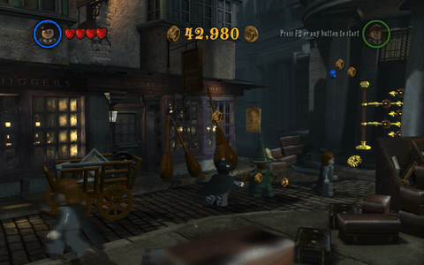
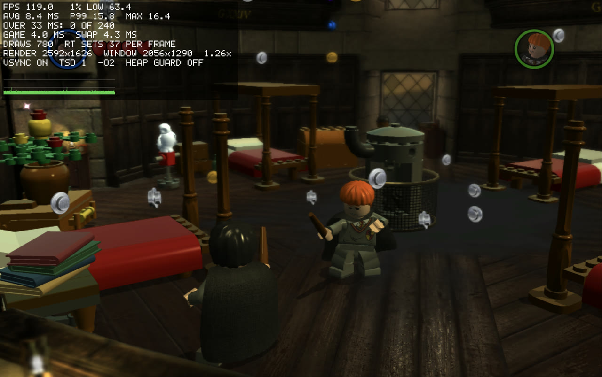

> [!IMPORTANT]
> This project does not include any game files. You need your own Steam copy of LEGO Harry Potter: Years 1-4 (the Windows version).

<h1 align="center">
  
  <br>
  Wizard Bricks Recompiled
</h1>

<p align="center">
  
  
  
</p>

<p align="center"><i>24-second video: <a href="docs/media/gameplay.mp4">gameplay.mp4</a></i></p>

LEGO Harry Potter: Years 1-4 (TT Games, 2010) came out on Steam for Windows only. This project turns the game's Windows code into C and compiles it into a Mac app for Apple Silicon. It does not use Wine or an emulator. The game's Direct3D 9 graphics go through [DXVK](https://github.com/doitsujin/dxvk) to Vulkan, and [KosmicKrisp](https://docs.mesa3d.org/drivers/kosmickrisp.html) runs Vulkan on Metal.

The translator and the Windows support are [MacRecomp](https://github.com/itsdunintime104/MacRecomp). It also runs [Indy Recompiled](https://github.com/itsdunintime104/IndyRecomp), [Hobbit Recompiled](https://github.com/itsdunintime104/HobbitRecompiled) and [Superheros Bricks Recompiled](https://github.com/itsdunintime104/SuperheroBrickRecomp).

This project is not affiliated with or endorsed by TT Games, Warner Bros. Games, Wizarding World or the LEGO Group.

## Contents

- [Requirements](#requirements)
- [Get the game files](#get-the-game-files)
- [Install](#install)
- [Playing](#playing)
- [Stutter and the shader warm-up](#stutter-and-the-shader-warm-up)
- [Saves](#saves)
- [Status](#status)
- [Performance](#performance)
- [Troubleshooting](#troubleshooting)
- [Building and development](#building-and-development)
- [Credits](#credits)
- [Support](#support)
- [License](#license)

## Requirements

- A Mac with Apple Silicon (M1 or newer)
- LEGO Harry Potter: Years 1-4 from Steam, Windows version, build 660 (Steam app 21130)
- Xcode Command Line Tools
- Homebrew with the packages listed in [Install](#install)
- Python 3.11 or newer
- About 3 GB of free disk space for the build, plus 6.3 GB for the game files

## Get the game files

Steam for Mac does not download this game, because it has no Mac version. Use one of these ways, with your own Steam licence:

1. **SteamCMD** (no Windows PC needed). Download [SteamCMD for macOS](https://steamcdn-a.akamaihd.net/client/installer/steamcmd_osx.tar.gz), unpack it, and run:
   ```sh
   ./steamcmd.sh +@sSteamCmdForcePlatformType windows +force_install_dir "$HOME/Games/LEGO Harry Potter" +login <your Steam user> +app_update 21130 validate +quit
   ```
2. **A Windows PC**: install the game with Steam and copy the `LEGO Harry Potter` folder to your Mac.
3. **Steam inside Wine, CrossOver or Whisky**: `setup.sh` finds the game there.

Use `LEGOHarryPotter.exe` as Steam installs it. It has no copy protection to remove, so do not run Steamless or any other patcher on it. `setup.sh` checks the file's SHA-256 checksum and stops if the file was changed.

**GOG copy.** [GOG sells the game](https://www.gog.com/en/game/lego_harry_potter_years_14) too, but it is not tested. `setup.sh` accepts it only if its `LEGOHarryPotter.exe` is the same file as the Steam build 660 (checksum `21c2d30c07e3ac68…`). If you try it, open an issue with the checksum that `setup.sh` prints.

## Install

1. Install the Xcode Command Line Tools, and wait until the installer says it is done:
   ```sh
   xcode-select --install
   ```
2. Install [Homebrew](https://brew.sh), then the tools:
   ```sh
   brew install sdl2 sdl3 faudio vulkan-loader vulkan-headers meson ninja pkgconf glslang \
       llvm spirv-llvm-translator spirv-tools zstd autoconf automake libtool bison flex mingw-w64 python
   ```
3. Get the code and run the setup script:
   ```sh
   git clone --recurse-submodules https://github.com/itsdunintime104/WizardBrick-Recomp.git
   cd WizardBrick-Recomp
   ./setup.sh "$HOME/Games/LEGO Harry Potter"
   ```
   Without a folder, setup looks in `~/Games`, Steam under Wine, CrossOver or Whisky, other Steam libraries, GOG installs and external drives. If it finds nothing, it asks; you can drag the folder into Terminal.
4. Open **LEGO Harry Potter Years 1-4** from `~/Applications`.

`setup.sh` checks your Mac and builds the graphics libraries (about 4 minutes, the first time only). Then it copies the game's exe, checks it, translates it, builds the app and installs it. It never writes to the game folder.

At the end, setup builds the game's shader cache. The game window opens for about 6 minutes and loads every level by itself; leave it open until it closes. This removes most of the stutter, but not all: see [Stutter and the shader warm-up](#stutter-and-the-shader-warm-up). `--no-warm` skips this step.

Keep the cloned folder: the app reads the game's exe from `orig.nosync/` in it. The app remembers the game folder.

| Option | Effect |
|---|---|
| `--check` | Only check the requirements |
| `--force` | Translate again. Use it after `git pull` |
| `--no-install` | Build the app in `build.nosync/` without copying it to `~/Applications` |
| `--no-warm` | Do not build the shader cache |
| `--dry-run` | Print each step without running it |

## Playing

| Key | Action |
|---|---|
| W A S D | Move |
| J | Cast a spell |
| K | Switch character |
| Return | Menus |
| Esc | Pause menu |
| Cmd+F | Show or hide the frame-rate overlay |
| Ctrl+Cmd+F | Switch between full screen and a window |
| Cmd+Q | Quit |

The game sees a controller, such as a DualShock 4, as an Xbox controller.

The game fills your screen without a border, at your display's size and refresh rate. To change that, set one of these before you open the app:

| Environment variable | Effect |
|---|---|
| `HPRECOMP_WINDOWED=1` | A window at the game's render size |
| `HPRECOMP_FULLSCREEN=1` | The game's own full screen, which changes the display mode |
| `HPRECOMP_GAME_DIR` | The game folder, if you moved it after setup |

Each run writes a log to `~/Library/Logs/HarryPotterRecomp/`. It holds startup messages, warnings and errors, not what you do in the game. The app keeps the newest 20. Attach the log when you report a problem.

## Stutter and the shader warm-up

> [!NOTE]
> Expect some stutter in your first hours of play. It fades as you visit more of the game.

The game compiles its shaders (small GPU programs) while you play. On a Mac, DXVK and Apple's Metal compiler then compile each new one, and the game waits for them. You see a short hitch, or a 1 to 3 second pause when a new level starts. Each shader is compiled only once and kept in the caches below, so later visits are smooth.

The warm-up at the end of `setup.sh` compiles most shaders before you first play. It loads each level and draws one frame. Spells, effects, characters and cutscenes that this frame does not show still compile the first time you see them.

| Cache | Folder | Holds |
|---|---|---|
| The game's shader cache | `~/Library/Application Support/HarryPotterRecomp/…/CachedShaders` | The game's shaders |
| Compiled shaders | `~/Library/Caches/HarryPotterRecomp/shaders` | The shaders that vkd3d-shader compiled for the game |
| DXVK cache | `~/Library/Caches/HarryPotterRecomp/dxvk` | DXVK's shader data |
| Apple's Metal cache | `$(getconf DARWIN_USER_CACHE_DIR)local.harrypotterrecomp` | The GPU code Apple's compiler made; this takes most of the compile time |

Do not delete these caches. If you do, the stutter comes back until they fill again.

The stutter can also come back:

- After an update of this project that changes how shaders are compiled. The app then clears the game's shader cache at the next launch. Run `./setup.sh` again: it skips the finished steps and builds the cache again.
- If the warm-up was skipped (`--no-warm`) or did not finish. Run `./setup.sh` again.
- Possibly after a macOS update, if macOS rebuilds its Metal cache. This is not tested yet.

With full caches, an 11-minute session had 0.09 late frames per second (see [Performance](#performance)).

## Saves

The game writes its saves and settings to its Windows profile folder. The app keeps that folder in `~/Library/Application Support/HarryPotterRecomp`. It never writes to the game folder.

> [!WARNING]
> Back up `~/Library/Application Support/HarryPotterRecomp` before you play.

## Status

The menus, saves, the Year 1 opening, the Leaky Cauldron, Diagon Alley and Gringotts work, with sound. Tests so far: a 20-minute run without input and several played sessions, with no crash.

- Short stutter the first time a new area, spell or effect appears. See [Stutter and the shader warm-up](#stutter-and-the-shader-warm-up).
- Scene changes show a black screen for 1-5 seconds.
- Some cutscenes show faint trails behind moving objects.
- Controllers: tested with a DualShock 4 in LEGO Indiana Jones, which uses the same code, but not yet in this game.

## Performance

Tested on a MacBook Pro 16-inch (2021) with an M1 Max (10-core CPU, 32-core GPU, 32 GB) and macOS 26.6. Full screen at 2056 × 1290 on a 120 Hz display.

| Test | Result |
|---|---|
| Played by hand for 11 minutes, with full shader caches | 120 FPS; 0.09 late frames per second; no frame over 100 ms |



*The Gryffindor dormitory at 2592 × 1626 with the overlay (Cmd+F): 119 FPS, slowest 1% of frames at 63.4 FPS, no frame over 33 ms in the last 240.*

## Troubleshooting

| Problem | Fix |
|---|---|
| "game folder not found" | Run `./setup.sh "<game folder>"`, or drag the folder into Terminal when setup asks |
| `setup.sh` says the checksum does not match | Only the unchanged Steam build 660 exe works. If a tool such as Steamless changed it, get the original back: run SteamCMD's `app_update 21130 validate`, or Steam's *Verify integrity of game files*. A GOG copy with another checksum does not work yet |
| macOS says the app is damaged | Build the app with `setup.sh` on your own Mac. A copy from another Mac does not run |
| Short stutter during play | New shaders are compiling. It fades as you revisit areas. If it happens everywhere, the caches were cleared: run `./setup.sh` again. See [Stutter and the shader warm-up](#stutter-and-the-shader-warm-up) |

## Building and development

[docs/BUILDING.md](docs/BUILDING.md) explains how the translation works, the Windows support, building by hand, the tests and the layout of this repo. The [MacRecomp README](https://github.com/itsdunintime104/MacRecomp#readme) covers the translator.

## Credits

- **[xboxrecomp](https://github.com/sp00nznet/xboxrecomp)** by sp00nznet: the x86-to-C translator that MacRecomp's translator started from (MIT license).
- **[DXVK](https://github.com/doitsujin/dxvk)** (zlib license), with the macOS patches from [jm2/dxvk](https://github.com/jm2/dxvk): Direct3D 9 to Vulkan.
- **[vkd3d-shader](https://gitlab.winehq.org/wine/vkd3d)** (LGPL-2.1): translates the game's shaders.
- **[Mesa](https://mesa3d.org) KosmicKrisp** (MIT license): Vulkan on Metal.
- **[FAudio](https://github.com/FNA-XNA/FAudio)** (zlib license): the game's sound.
- **[SDL](https://www.libsdl.org/)** (zlib license): window, keyboard and controllers.
- **[Capstone](https://www.capstone-engine.org/)** (BSD license): reads x86 instructions for the translator.
- **[Wine](https://www.winehq.org)**: used only to compare Windows behaviour during development, and its `widl` tool to build vkd3d. No Wine code is in the app.

## Support

[](https://buymeacoffee.com/itdunintime)

| Currency | Address |
|:---------|:--------|
| BTC | `1A7DmUpKRkuoSTKkWDcFR6SBdtpGqa1R8x` |
| ETH | `0x772a320ff05c763eae76868b971b6d53daee36e7` |
| SOL | `En858GF2YnTtTo4rmGfdTADof5gdVMGv1d13favtAbS5` |
| USDT (ERC-20) | `0x772a320ff05c763eae76868b971b6d53daee36e7` |

## License

GPL-3.0. See [LICENSE](LICENSE). Third-party code keeps its own license: see `engine/tools/xrecomp/LICENSE`, `engine/tools/xrecomp/NOTICE` and the header of `engine/runtime/src/dlmalloc.c`. The patches in `engine/windows/tools/` keep the license of the project they patch.

The repository contains no game files, no game exe and no code made from the game. `recon/` holds function addresses, import names and switch tables read from the game's exe, which the translator needs. The app icon is made from your own copy of the game when you build.
